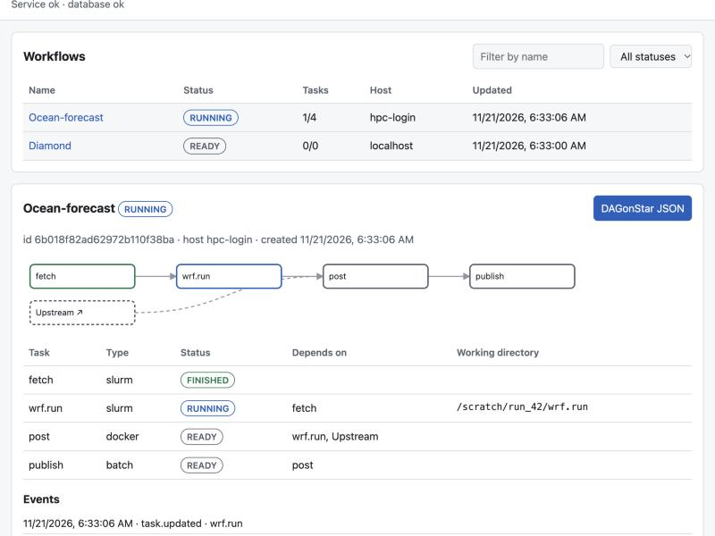

# DAGonService

[](https://github.com/DagOnStar/DagOnService/actions/workflows/ci.yml)
[](https://github.com/DagOnStar/DagOnService/actions/workflows/docker-publish.yml)
[](LICENSE)

DAGonService is the registration and remote-monitoring service of the
[DAGonStar](https://github.com/DagOnStar/dagonstar) workflow engine. A DAGonStar
workflow with `[dagon_service] use = True` registers itself when it is created,
reports every task transition while it runs, and resolves `workflow://`
references to tasks of **other** registered workflows (transversal workflows).
Operators follow runs in a built-in dashboard, and
[DAGonWeb](https://github.com/DagOnStar/DAGonWeb) and other tools read the same
record through a versioned JSON API.

The service targets **DAGonStar 3.0.0**, the revision DAGonWeb pins, and keeps
the exact HTTP contract of its built-in client: existing DAGonStar
installations work unchanged.



## Highlights

- **Drop-in for DAGonStar.** Every route the DAGonStar client calls keeps its
  path, verb, status code and response shape, verified by tests that run the
  real DAGonStar client against a live server.
- **Correct under concurrency.** DAGonStar reports from parallel task threads;
  every update is a single atomic MongoDB operation, so no report is lost.
- **Task history and events.** Each task keeps the time-stamped sequence of its
  states; every observation is also an event that monitors can poll
  incrementally or receive by webhook.
- **Aggregate status.** Each workflow reports `READY`, `WAITING`, `RUNNING`,
  `FINISHED` or `FAILED`, with per-state counts.
- **Transversal workflows.** Workflows find each other by name; cross-workflow
  edges are recorded and flagged.
- **Faithful documents.** The registered DAGonStar task-map document, including
  every task type's own fields and DAGonWeb's `dagonweb` extension, is exported
  unchanged by `/api/v1/workflows/<id>/document` and reloads in DAGonStar or
  imports into DAGonWeb.
- **Dashboard.** A build-free, read-only page with the workflow list, a
  dependency graph, the task table and the event log; light and dark themes,
  usable on a phone.
- **Operable.** Gunicorn, MongoDB 7, health checks, an unprivileged container,
  a duplicate-name policy, an optional access token (sent by DAGonStar
  releases after 3.0.0 from `[dagon_service] token`), and strict validation.
- **Upgradable.** One script migrates a 1.x deployment (MongoDB 4.0) and
  converts its documents ([deployment guide](docs/deployment.md#migrating-the-data)).
- **Delivered continuously.** CI on every push; multi-architecture images on
  `ghcr.io/dagonstar/dagonservice` from `main` and release tags.

## Quick start

```bash
docker compose up --build -d
curl http://localhost:57000/api/v1/health
```

Once an image has been published from `main` or a release tag, you can skip
the build by setting `image: ghcr.io/dagonstar/dagonservice:main` (or a version
tag) for the `dagon_service` service.

Then enable the service in your workflow's `dagon.ini`:

```ini
[dagon_service]
route = http://localhost:57000
use = True
```

run any DAGonStar program, and open <http://localhost:57000/>. The
[Getting started](docs/getting_started.md) guide walks through a complete example.

## How it fits together

```
 DAGonStar program ──(legacy routes: /create, /changestatus, /update, ...)──┐
 DAGonWeb run (use = True) ────────────────────────────────────────────────┤
                                                                            ▼
                                     DAGonService (Flask, Gunicorn) ── MongoDB
                                                                            │
 Dashboard (/), DAGonWeb import, scripts ◄──(/api/v1: workflows, events, graph, document)
 Webhook receivers ◄──(events, best effort)
```

## Documentation

| | |
| --- | --- |
| [Introduction](docs/introduction.md) | Why an external registry, and the core concepts. |
| [Getting started](docs/getting_started.md) | First workflow in five minutes. |
| [Architecture](docs/architecture.md) | Components, concurrency model, design decisions. |
| [Data model](docs/data_model.md) | Stored document, states, aggregate status, events, duplicate policy. |
| [API reference](docs/api.md) | Legacy DAGonStar routes and `/api/v1`. |
| [DAGonStar integration](docs/dagonstar_integration.md) | Client life cycle, transversal workflows, known client limits. |
| [DAGonWeb integration](docs/dagonweb_integration.md) | Using both together; moving documents between them. |
| [Dashboard](docs/dashboard.md) | The monitoring page. |
| [Configuration](docs/configuration.md) | Environment variables. |
| [Deployment](docs/deployment.md) | Compose, production checklist, upgrading from the prototype. |
| [Security](docs/security.md) | Threat model, token, recommendations. |
| [Developer guide](docs/developer_guide.md) | Layout, tests, rules for changes. |
| [Assessment report](docs/assessment.md) | 2026 audit of the prototype and how each finding was fixed. |

## Development

```bash
python -m venv .venv && . .venv/bin/activate
pip install -r requirements-dev.txt
pytest
```

The tests use mongomock and need no database server; the alignment tests
install and run DAGonStar. See [AGENTS.md](AGENTS.md) for the rules every change
must follow, and [CHANGELOG.md](CHANGELOG.md) for the release history.

## License

DAGonService is distributed under the [Apache License 2.0](LICENSE), like
DAGonStar and DAGonWeb. See [NOTICE](NOTICE).

## Requirements

- Docker and Docker Compose, or
- Python 3.10+ and MongoDB 4.4+ (7.0 recommended).
