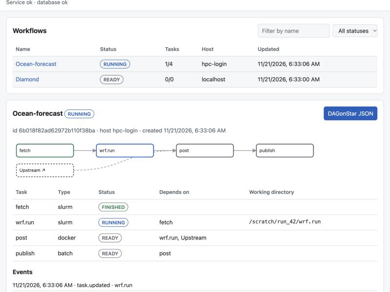

# Dashboard

The service serves a read-only monitoring page at `/`.

## What it shows

- **Service health** — the result of `/api/v1/health`, refreshed with the page.
- **Workflows** — every registration, newest first, with its aggregate status,
  the number of finished tasks, the registering host and the last update.
  The list can be filtered by name and by status.
- **Workflow detail** — selected by clicking a name:
  - a dependency graph laid out in columns by depth, with node borders coloured
    by status, explicit and inferred edges drawn solid, and transversal
    predecessors (tasks of other workflows) drawn as dashed nodes marked ↗;
  - the task table: type, status, predecessors, and working directory;
  - the event log, newest first, fetched incrementally;
  - a **DAGonStar JSON** button that downloads the `/document` export.

The page polls the API every `DAGONSERVICE_DASHBOARD_REFRESH_MS` milliseconds
(default 3000) while the browser tab is visible, and re-renders only the parts
whose data changed, so keyboard focus and the current selection are preserved.

## Design constraints

The dashboard follows the front-end rules of DAGonWeb:

- plain browser JavaScript and CSS, no build step and no third-party assets,
  so it works offline and under a strict Content Security Policy
  (`default-src 'self'`);
- every server-provided string is inserted with `textContent`, never parsed as
  HTML;
- light and dark themes follow the operating system (`prefers-color-scheme`),
  status is conveyed by text as well as colour, controls have labels, and a
  skip link leads to the content;
- at phone width the tables drop the least important column and the graph
  scrolls inside its own box, so the page never scrolls horizontally.

## Access control

When `DAGONSERVICE_API_TOKEN` and `DAGONSERVICE_PROTECT_READS` are both set,
the page asks for the token and keeps it in the tab's `sessionStorage` only.
Set `DAGONSERVICE_DASHBOARD=false` to serve a small JSON description at `/`
instead.
